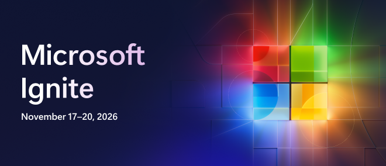

---

<a name="start-building"></a>

<p align="center">

</p>

# [Microsoft Ignite 2026](https://ignite.microsoft.com)

## 🔥LAB668: Host apps from anywhere with the new Copilot Managed Runtime
### Session description

Get hands-on with Copilot Managed Runtime and learn how to bring apps built with Microsoft and third-party tools into a managed enterprise environment. You’ll deploy and run an app, explore different entry points, and see how the runtime provides the connectivity and management needed to take AI-generated code from prototype to enterprise use.

**Delivery links:** Pending — session and slide deck links are not available yet.

### 🚀 Getting started

#### In a guided session

Open the [attendee instructions](instructions/README.md) and follow the
facilitator's guidance. Your facilitator will provide the lab account and
current access details for Cowork and Copilot Studio.

#### On your own

Follow the [attendee instructions](instructions/README.md). The core lab runs
in a browser; no local SDK or CLI setup is required.

### 🎯 Learning outcomes

By the end of this session, you will be able to:

- Configure Copilot Managed Runtime to bring apps built with Microsoft and third-party tools into a managed enterprise environment.
- Deploy and run an app in Copilot Managed Runtime and explore different entry points.
- Describe how the runtime's connectivity and management capabilities help move code from prototype to enterprise use.

### 💻 Technologies used

- Copilot Studio
- Copilot Cowork
- Copilot Code
- Copilot Managed Runtime (SDK and CLI)
- M365

### 📚 Continue your learning

Pick your next step based on your learning style:

| Resource | What you'll get |
|----------|-----------------|
| **[Ignite 2026 Next Steps](https://aka.ms/ignite26-next-steps)** | Additional session repos and materials from Microsoft Ignite 2026 |
| **[Microsoft AI Skills Navigator](https://aka.ms/ignite26-asn)** | Discover AI skills, learning paths, and resources for your next step |
| **[Microsoft Learn](https://aka.ms/ignite26-learn)** | Official documentation and guided learning paths on these topics |
| **[Microsoft Copilot Managed Runtime Blogpost](https://aka.ms/CopilotManagedRuntime-Blog)** | Review the launch blog of Copilot Managed Runtime |

### 🌟 Microsoft Learn MCP Server

The Microsoft Learn MCP Server gives your AI agent direct access to Microsoft's official documentation — grounded, up-to-date answers about the topics in this session.

**GitHub Copilot CLI** — Install with:

```shell
copilot plugin install microsoftdocs/mcp
```

**VS Code** — One-click install:  
[](https://vscode.dev/redirect/mcp/install?name=microsoft-learn&config=%7B%22type%22%3A%22http%22%2C%22url%22%3A%22https%3A%2F%2Flearn.microsoft.com%2Fapi%2Fmcp%22%7D)

For more information, visit the [Learn MCP Server repo](https://aka.ms/learnmcp).

### 👥 Content owners

<table>
<tr>
    <td align="center"><a href="https://github.com/laskewitz">
        <br />
        <sub><b>Daniel Laskewitz</b></sub></a><br />
            <a href="https://github.com/laskewitz" title="talk">📢</a>
    </td>
    <td align="center"><a href="https://github.com/aprildunnam">
        <br />
        <sub><b>April Dunnam</b></sub></a><br />
            <a href="https://github.com/aprildunnam" title="talk">📢</a>
    </td>
    <td align="center"><a href="https://github.com/flow-joe">
        <br />
        <sub><b>Joe Unwin</b></sub></a><br />
            <a href="https://github.com/flow-joe" title="talk">💡</a>
    </td>
</tr></table>

### ⚖️ Trademarks

This project may contain trademarks or logos for projects, products, or services. Authorized use of Microsoft trademarks or logos is subject to and must follow [Microsoft's Trademark & Brand Guidelines](https://www.microsoft.com/legal/intellectualproperty/trademarks/usage/general). Use of Microsoft trademarks or logos in modified versions of this project must not cause confusion or imply Microsoft sponsorship.

Any use of third-party trademarks or logos are subject to those third-party's policies.
