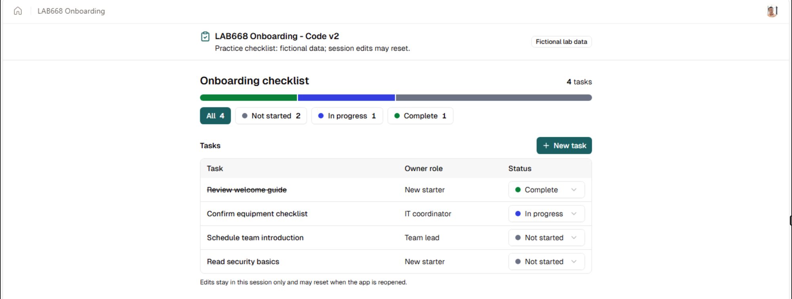

# Create and publish apps with Copilot Managed Runtime

**Focus:** Create apps with Copilot Code and Copilot Studio and publish them to Microsoft Copilot Managed Runtime.

In this lab, you'll build interactive apps in Copilot Code and Copilot Studio, publish them to Copilot Managed Runtime (CMR), and open them outside the authoring preview. Each exercise uses the same fictional scenario to create a separate app. No manual transfer between products or prior coding experience is required.

Here's an example of the onboarding checklist app from the Copilot Code exercise. Your app may look different.

The hands-on exercises focus on creating and publishing apps; you won't share them with others. You'll also find links to learn about the SDK and CLI as a code-first alternative. Using or installing them is not part of this lab.

Your facilitator will provide the lab account and access instructions for the features available in the session.

## Learning outcomes

By the end, you should be able to:

- Create, preview, test, and publish separate interactive apps with Copilot Code and Copilot Studio.
- Revise the Copilot Code app with a **New task** modal and a completion progress bar, then verify the published changes.
- Explore device previews and add and test a light/dark mode switch in the Copilot Studio app.
- Optionally inspect generated source code in Copilot Studio.
- Distinguish authoring preview from a published app, and explain how publishing differs from sharing and data access.

These experiences overlap. The choice of starting point does not establish different intrinsic app capabilities or automatic cross-client handoff.

## Schedule

Times are elapsed minutes from the start of the session.

| Time | Minutes | Activity |
| --- | ---: | --- |
| 00–15 | 15 | Intro presentation |
| 15–35 | 20 | Exercise 1: Copilot Code |
| 35–55 | 20 | Exercise 2: Copilot Studio |
| 55–75 | 20 | Wrap-up |
| **Total** | **75** | |

## Getting started:

1. If needed, log in to the Virtual Machine using the password +++@lab.VirtualMachine(LAB668).Password+++

   > **Note:** To ensure text is entered accurately, avoid interacting or clicking in the VM until the text has finished being typed.
