# 1 - Build the app with Copilot Code

## Exercise 1 — Copilot Code:

Build, publish, and then revise the same app in this exercise.

### Get started

1. Open Microsoft Edge (a shortcut is on the desktop).
1. Go to +++https://copilot.cloud.microsoft/home+++
1. Sign in using the username and Temporary Access Pass below.

    **Username:** +++@lab.CloudCredential(WWLM365E7).AdministrativeUsername+++<br />
    **Temporary Access Pass:** +++@lab.Variable(TAP)+++

    If a welcome screen appears, click **X** to close it and continue.

1. Select the **Code** button shown in the screenshot.

    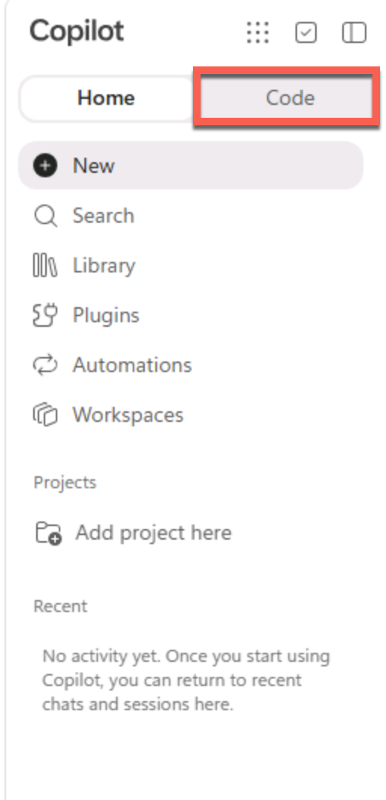

### Prepare the prompt

The prompt describes the desired app, its behaviors and accessibility, fictional data and storage boundaries, and publishing expectations.

1. Copy the entire prompt below and paste it once into the Copilot Code prompt box. Copy only the contents of the block, not the backticks.

    ```text
    Create LAB668 Onboarding - Code as a managed app

    Create a supported interactive managed app for this lab, not a static HTML
    page, agent, or workflow. Use the exercise's LAB668 Onboarding title.

    Display a fictional onboarding checklist with task, owner role, and status.
    Status choices must be Not started, In progress, and Complete.
    Show the total task count and counts by status. Allow filtering by status,
    adding a task, and editing a task's status. Require a nonempty task name.
    Keep the interface small, readable, and keyboard usable.

    Start with the pasted JSON fixture. Label the screen "Fictional lab data".
    Use session-local or illustrative local state; do not connect to enterprise
    data or promise durable, shared, cross-user storage. State that edits may
    reset when reopened. Do not add a backend, call agents or workflows, or
    request additional services. Keep scope to this brief.

    Prepare the app for the entry point's supported Copilot Managed Runtime
    publish/deploy path. Do not treat a preview or source-code update as a
    confirmed hosted deployment.

    [
      {
        "id": "T1",
        "task": "Review welcome guide",
        "ownerRole": "New starter",
        "status": "Complete"
      },

      {
        "id": "T2",
        "task": "Confirm equipment checklist",
        "ownerRole": "IT coordinator",
        "status": "In progress"
      },

      {
        "id": "T3",
        "task": "Schedule team introduction",
        "ownerRole": "Team lead",
        "status": "Not started"
      },

      {
        "id": "T4",
        "task": "Read security basics",
        "ownerRole": "New starter",
        "status": "Not started"
      }
    ]
    ```

1. Review the complete prompt, including all four fictional tasks, then send it to Copilot Code.

    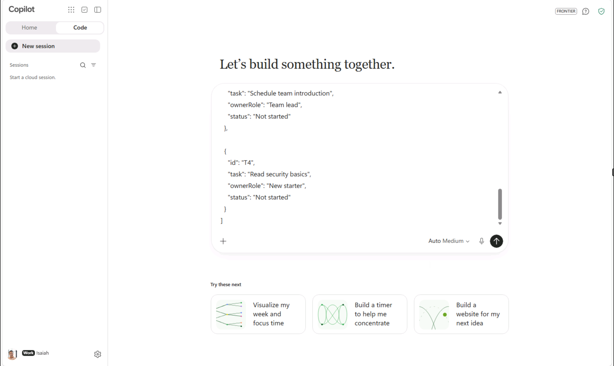

### Build and explore the app

1. After sending the prompt, confirm the activity shows **Used skill app-generation**. If the activity is not visible, you might need to expand the activity in the chat so that Code shows you what it's doing behind the scenes.

    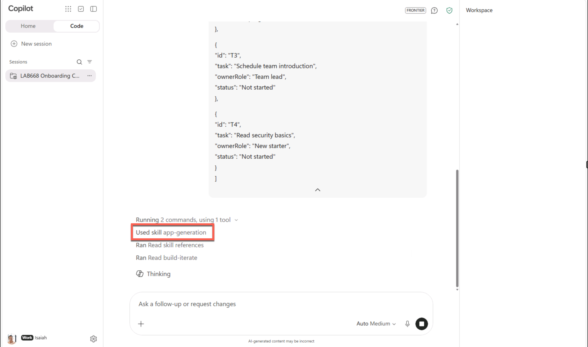

    Generation builds the source files and an interactive preview. These may become available before the agent finishes; you can inspect them while it continues working.

1. When the app is available under **Output**, select **Open LAB668 Onboarding** to inspect the preview while generation continues. If the app opens to the side automatically, use that preview. You can also select **Open** at the bottom of the chat conversation when available.

    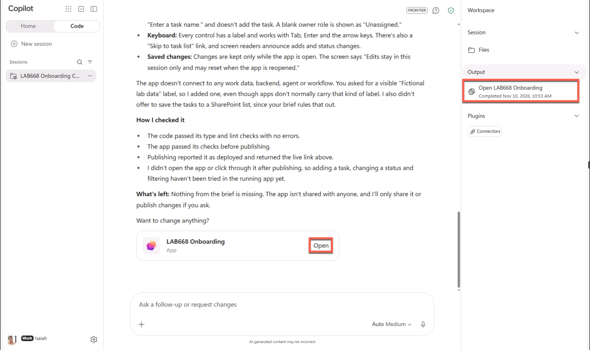

    If **Output** is not ready yet, wait and check again. **Files** is hidden while the preview is open; this does not mean generation is unfinished. Close the preview as described below to see **Files**. **Optional:** Open [Build and publish apps to Copilot Managed Runtime](https://learn.microsoft.com/copilot/code/use-code#build-and-publish-apps-to-copilot-managed-runtime) in a separate browser tab while you wait, then switch back to the Copilot Code browser tab.

1. **Optional:** Expand the app by selecting the expand icon highlighted at the upper-right of the Preview pane.

    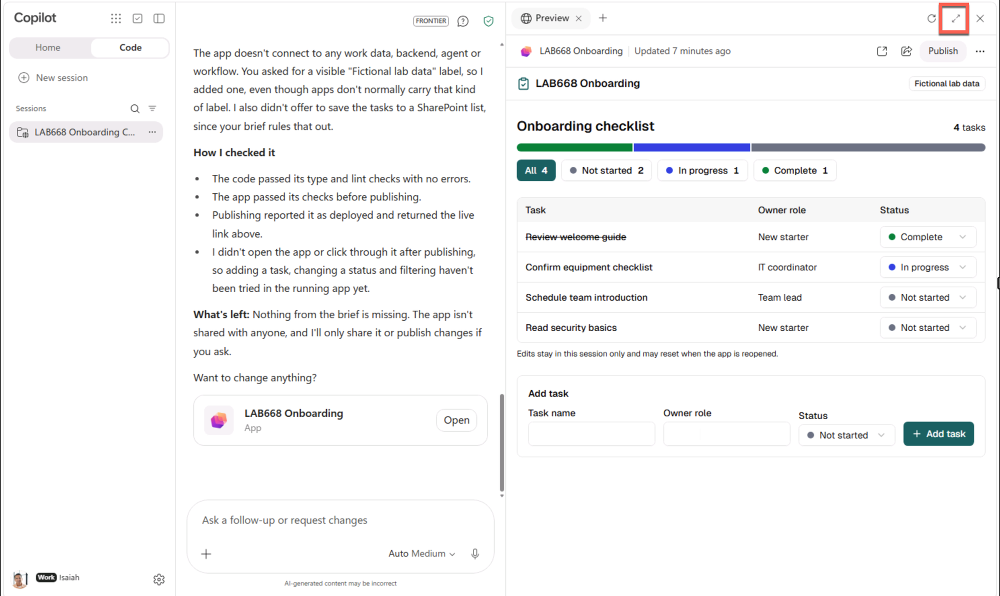

1. If you expanded the preview, select the restore-size icon highlighted below to reveal the conversation and return the app canvas to its previous size. Restoring the size does not close the preview or reveal **Files**.

    

1. To inspect the source, close the app preview pane by selecting its upper-right **X**, highlighted below. **Files** is visible only when the preview pane is closed. Close the preview, not the browser tab.

    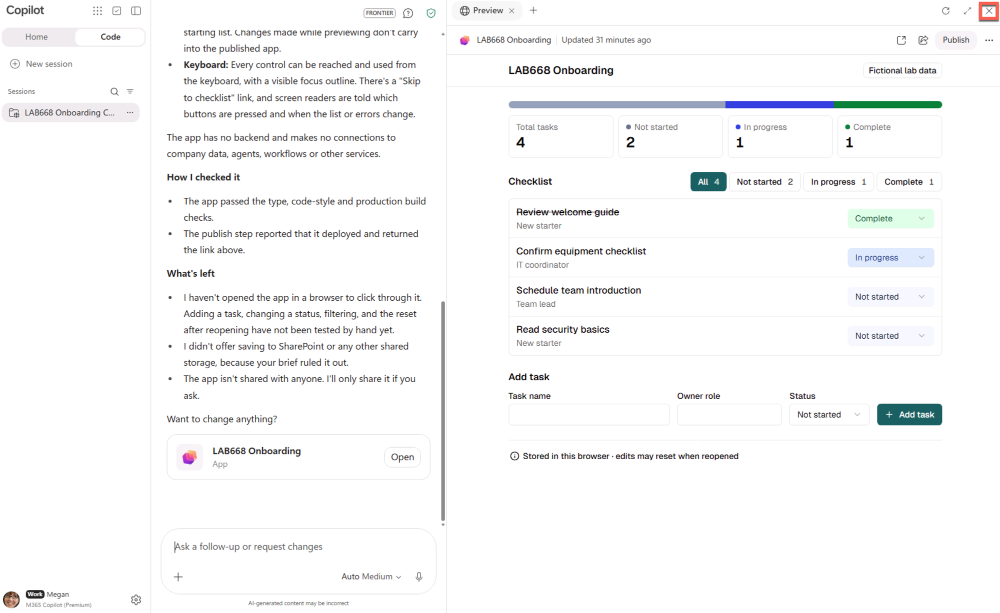

1. In **Workspace** on the right, select **Files**.

    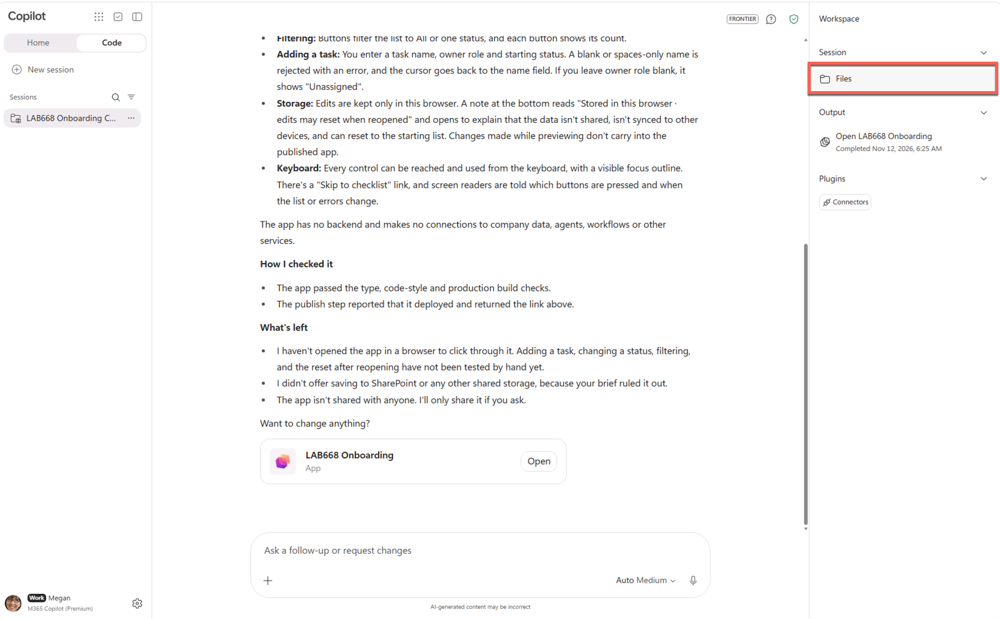

    Locate the generated source files and open the relevant app source. If the source files are not ready yet, wait and check again. Look for the checklist interface and the fictional tasks from the prompt; generated filenames and the way the data is represented may vary. Inspect only; no code edits are required.

1. Reopen the app by selecting **Open LAB668 Onboarding** under **Output** or **Open** in the conversation, then continue with the app preview and conversation.

1. Before requesting any revision or publishing, wait until the initial generation has finished. Confirm you received an interactive app rather than only an explanation or static document.

### Improve and test task entry

1. In the app preview, confirm **Fictional lab data** is visible and the original four tasks appear. Check that the total is four, with one **Complete**, one **In progress**, and two **Not started**. Test status filtering and editing, restore any changed status, and confirm an empty task name cannot be added. Check that the controls can be used with the keyboard.

1. In the Copilot Code conversation, request this focused task-form change:

    ```
    Keep the existing app and fixture unchanged.
    Move the existing task form into an accessible modal opened by a **New task** button with a Cancel option.
    Preserve all existing interactions.
    ```

1. Preview the change. Confirm **New task** opens the form in a modal that can be operated with the keyboard, and **Cancel** closes it without adding a task. Verify filtering and status editing still work, restoring any status you change.

    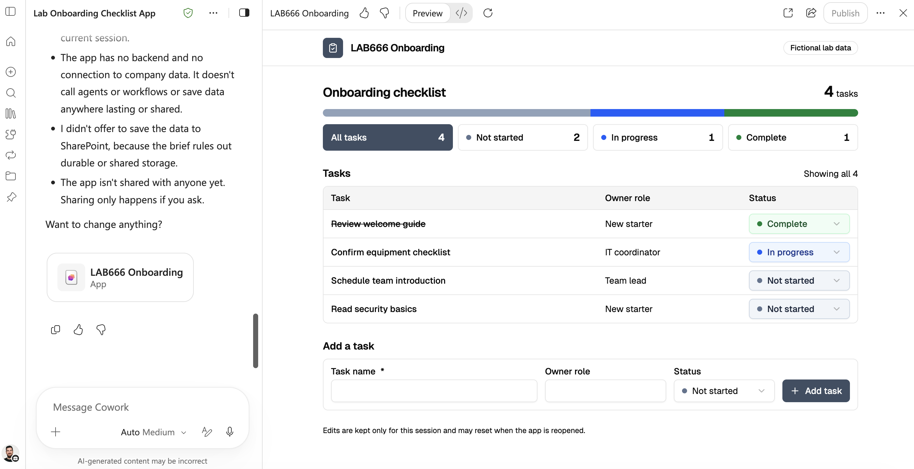

    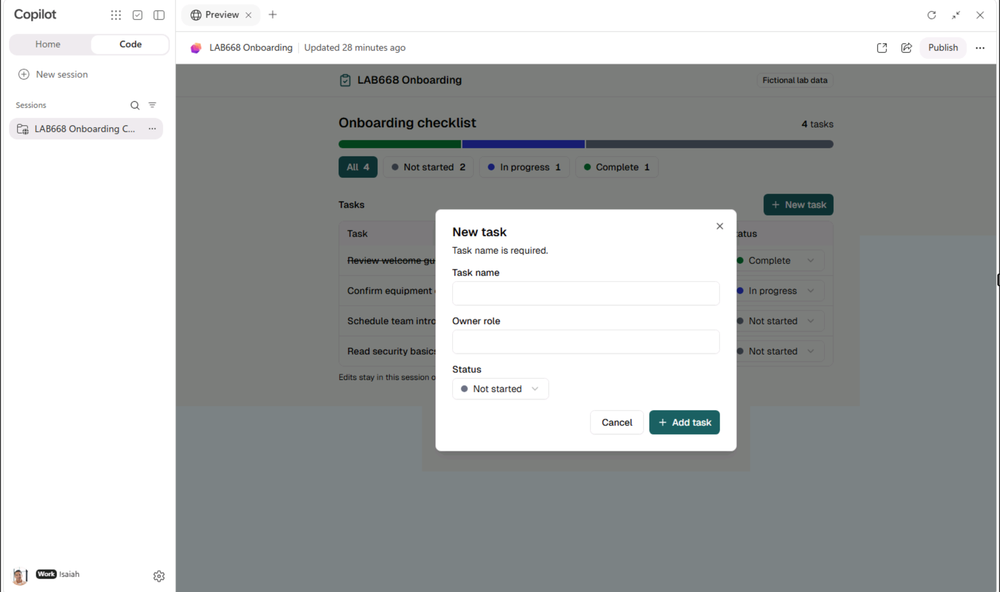

1. In the interactive app preview, use the **New task** modal to add two fictional onboarding tasks:

    1. Select **New task** to open the modal for the first task.
    1. Enter +++Schedule welcome meeting+++ as the task name.
    1. Enter +++Team lead+++ as the owner role.
    1. Select **Not started** as the status, or keep it if already selected.
    1. Select **Add task**.
    1. Select **New task** again to open the modal for the second task.
    1. Enter +++Set up workstation+++ as the task name.
    1. Enter +++IT coordinator+++ as the owner role.
    1. Select **In progress** as the status.
    1. Select **Add task**.

    Confirm both tasks appear in the list and the total task count increases by two. These preview edits may reset when the app is reopened.

### Publish the app

1. Select **Publish** in the Preview pane. Wait for the **Your app is published** confirmation before opening the published app.

    Publishing makes the requested version separately available through Copilot Managed Runtime; a working preview alone does not confirm publication. **Optional:** Open [What is Copilot Managed Runtime](https://learn.microsoft.com/en-us/microsoft-365/managed-apps/) in a separate browser tab while you wait, then switch back to the Copilot Code browser tab to check the confirmation. Publishing is not sharing; do not share the app with others in this lab.

1. In the publishing confirmation, select **Open app**. Use the same lab account if needed, and confirm the published app looks and works as expected.

    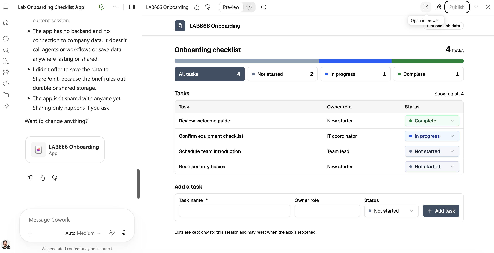

### Update and republish

1. Switch back to the Copilot Code browser tab containing the conversation. If the preview is expanded, use the restore-size control to reveal the conversation. Request this small change:

    ```
    Keep the app and fixture unchanged. Change the visible app title to
    "LAB668 Onboarding — Code v2" and add this sentence below it:
    "Practice checklist: fictional data; session edits may reset."
    Keep all existing interactions working.
    ```

    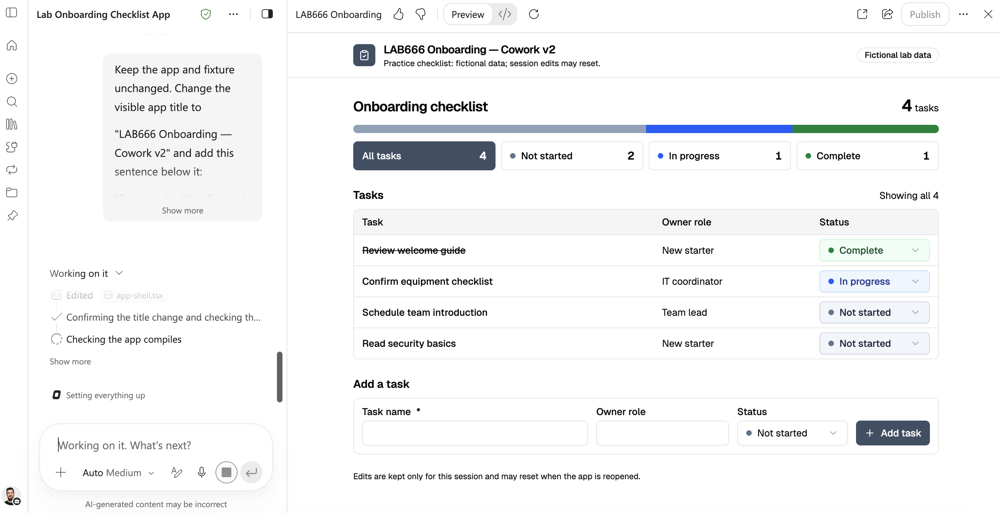

1. Confirm the new title and sentence in preview.
1. In the Copilot Code conversation, type +++Publish it live+++ and send the prompt to publish the app with the latest changes. Wait for confirmation that publishing has completed.
1. Switch to the browser tab containing the published app and reopen or refresh it. Confirm “Code v2” and the new sentence appear, then test filtering and adding a task again.

    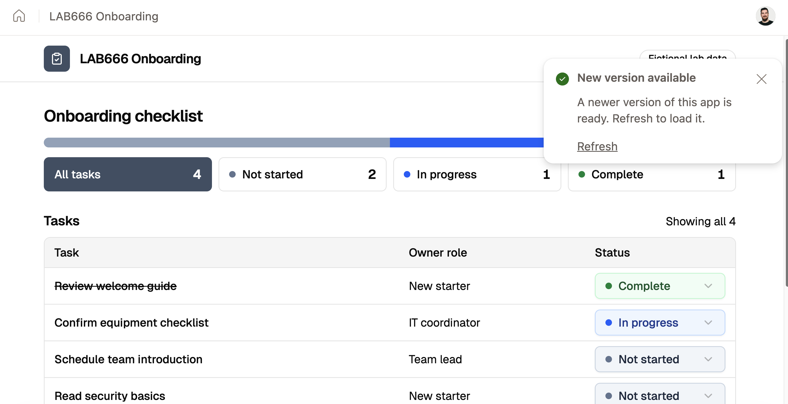

1. Check the title.

    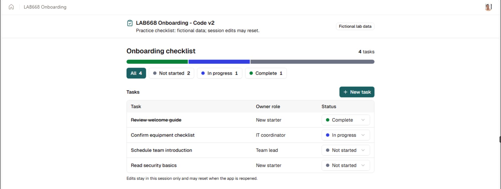

### Add and publish completion progress

1. Switch back to the Copilot Code browser tab containing the conversation. If the preview is expanded, use the restore-size control to reveal the conversation. Request this final revision:

    ```
    Keep the existing app and fixture unchanged.
    Add a progress bar showing the percentage of tasks marked Complete; update it when tasks are added or their status changes.
    Preserve all existing interactions.
    ```

1. Preview the revision. Verify the progress percentage matches completed tasks divided by total tasks. For reference, the original four-task fixture yields 25%, while six tasks with one complete yield about 17%. Change a task's status and add a task using the existing **New task** button; confirm the percentage updates after each change and existing filtering and status editing still work.

    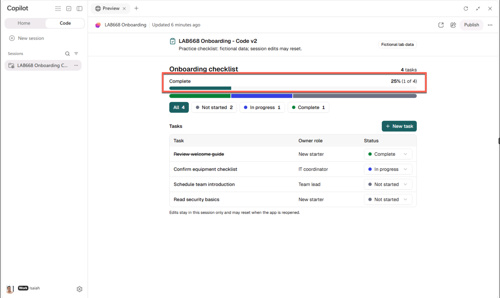

1. In the Copilot Code conversation, type +++Publish it live+++ and send the prompt to publish the app with the latest changes. Wait for confirmation that publishing has completed.

    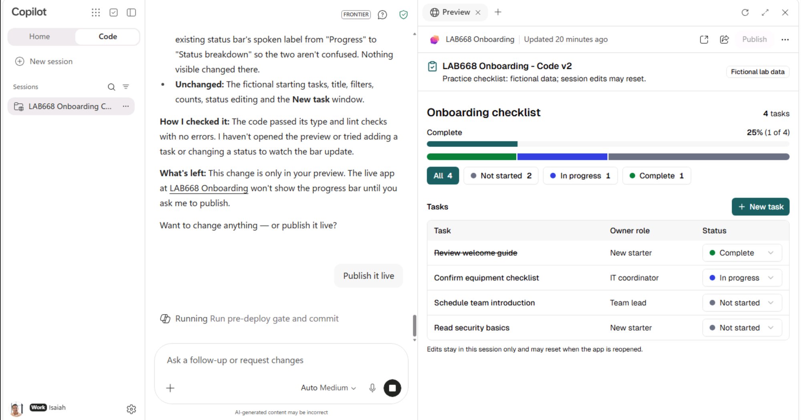

1. After the revision is published, switch to the browser tab containing the published app and reopen or refresh it. Verify the progress percentage updates after a status change and a new task, and confirm the existing **New task** modal and **Cancel** option still work.

## Exercise end

You built and published an app with Copilot Code, inspected its generated source in **Files**, updated its title, moved task creation into an accessible **New task** modal, and added a completion progress bar. You reopened the app to confirm the percentage updates and task interactions work.

Select **Next** to continue to the next exercise.
