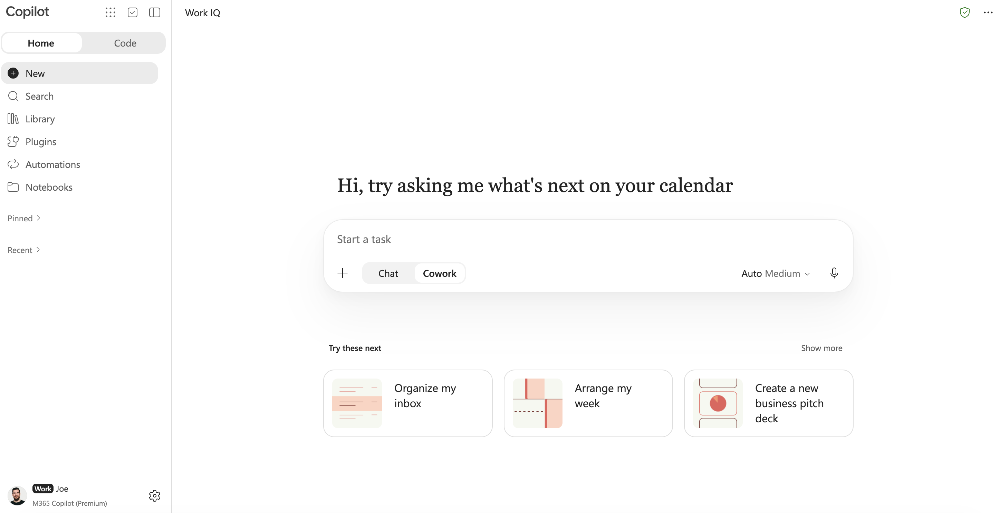
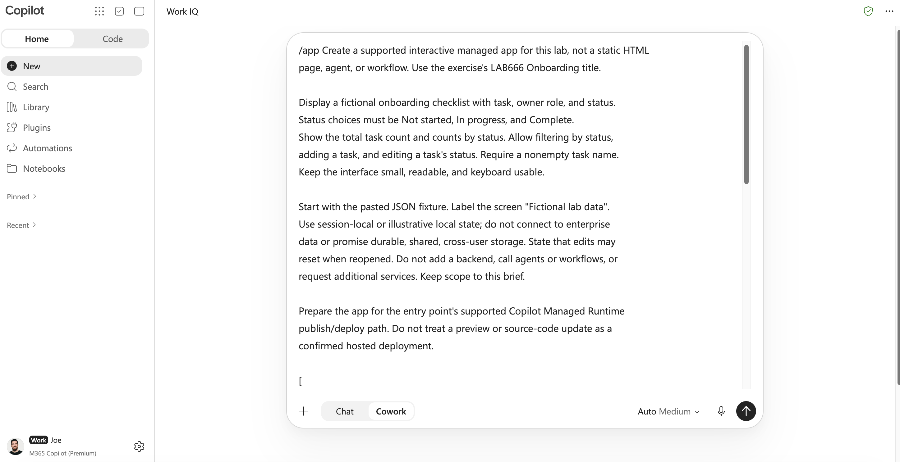
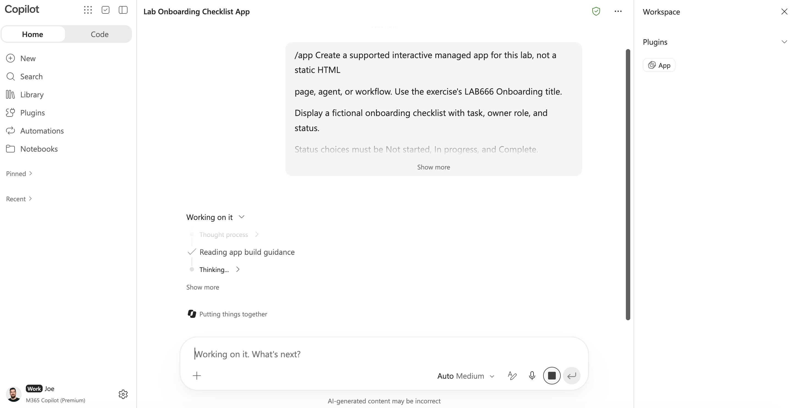
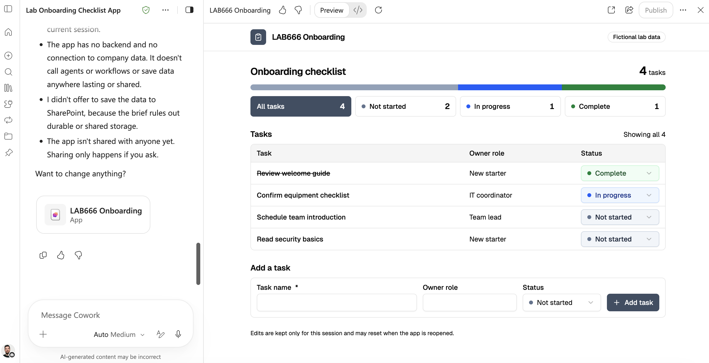
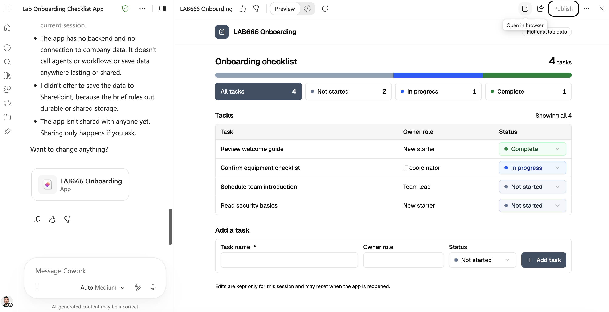
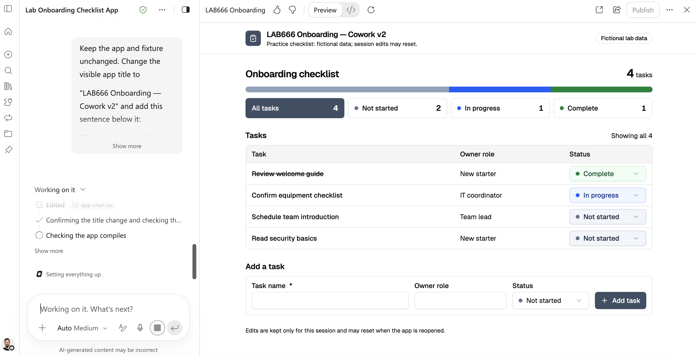
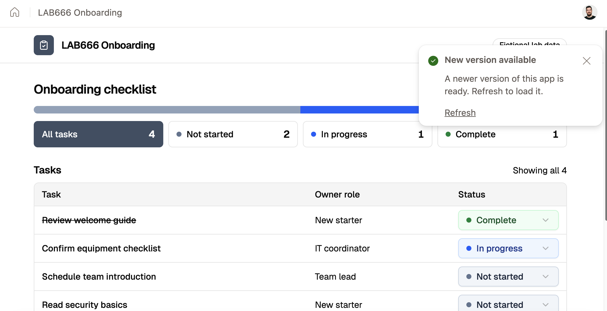
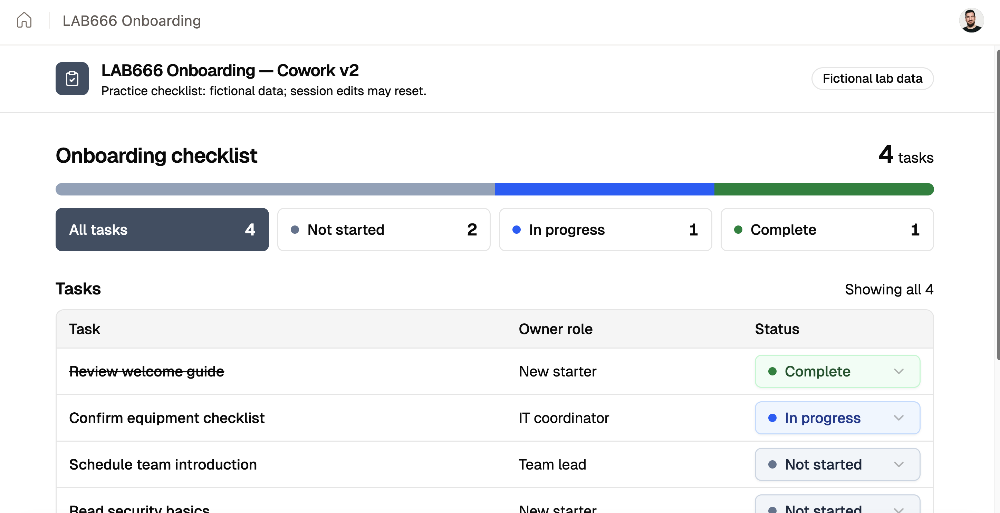

# 1 - Build the app with Cowork

## Exercise 1 — Cowork:

Cowork fits broader work tasks where creating an app is part of getting the work done. Build, publish, and then revise the same app in this exercise.

1. Go to +++https://copilot.cloud.microsoft/home+++
1. Sign in using the username and Temporary Access Pass below.

    Username: +++@lab.CloudCredential(WWLM365E7).AdministrativeUsername+++  
    Temporary Access Pass: +++@lab.Variable(TAP)+++

    If a welcome screen appears, click **X** to close it and continue.

1. Select the Cowork button.
    

1. In the Cowork prompt box, type +++/app+++ to select app creation.
1. Copy the entire **App brief text** block below and paste it into the Cowork prompt box. Copy the entire **JSON demo data fixture** block and paste it after the brief in the same prompt. Copy only the contents of each block, not the backticks. Do not send the prompt yet.

    **App brief text**

    ```
    Create a supported interactive managed app for this lab, not a static HTML
    page, agent, or workflow. Use the exercise's LAB668 Onboarding title.

    Display a fictional onboarding checklist with task, owner role, and status.
    Status choices must be Not started, In progress, and Complete.
    Show the total task count and counts by status. Allow filtering by status,
    adding a task, and editing a task's status. Require a nonempty task name.
    Add a light/dark mode switch so users can choose either appearance.
    Keep the interface small, readable, and keyboard usable.

    Start with the pasted JSON fixture. Label the screen "Fictional lab data".
    Use session-local or illustrative local state; do not connect to enterprise
    data or promise durable, shared, cross-user storage. State that edits may
    reset when reopened. Do not add a backend, call agents or workflows, or
    request additional services. Keep scope to this brief.

    Prepare the app for the entry point's supported Copilot Managed Runtime
    publish/deploy path. Do not treat a preview or source-code update as a
    confirmed hosted deployment.
    ```

    **JSON demo data fixture**

    ```
    [
      {
        "id": "T1",
        "task": "Review welcome guide",
        "ownerRole": "New starter",
        "status": "Complete"
      },

      {
        "id": "T2",
        "task": "Confirm equipment checklist",
        "ownerRole": "IT coordinator",
        "status": "In progress"
      },

      {
        "id": "T3",
        "task": "Schedule team introduction",
        "ownerRole": "Team lead",
        "status": "Not started"
      },

      {
        "id": "T4",
        "task": "Read security basics",
        "ownerRole": "New starter",
        "status": "Not started"
      }
    ]
    ```

    Once the brief and JSON data are both in the same prompt, send it to Cowork.

    

1. Allow generation to finish. Confirm you received an interactive app rather than only an explanation or static document. Observe its authoring preview.
    

1. Run a standard preview test, ensuring everything is working. If needed, type one focused correction such as +++Keep the existing app. Fix only the failing checklist test and preserve the fixture and scope.+++
    

1. If your app was not published, click publish to deploy to Copilot Managed Runtime, making your app hosted, secure, governed and shareable.
1. Click **Open in browser**. This will then open it in a new browser tab (make sure you're using the same lab account if you cannot access), confirm the app looks and works the same.
    

1. Return to authoring and request this small change:

    ```
    Keep the app and fixture unchanged. Change the visible app title to
    "LAB668 Onboarding — Cowork v2" and add this sentence below it:
    "Practice checklist: fictional data; session edits may reset."
    Keep all existing interactions working.
    ```

    

1. Confirm the new title and sentence in preview.
1. Click publish. Then, once published, reopen or refresh the current hosted deployment link independently of authoring. Selected "refresh" on the updated app pop-up. Confirm “Cowork v2” and the new sentence appear, then test filtering and adding a task again.
    

1. Check the title.
    

**Checkpoint:** A hosted app opens independently of the Cowork preview and shows the revision with working interactions. Preview alone is not completion; iIf publishing fails, observe the prepared hosted app by the lab providers.
