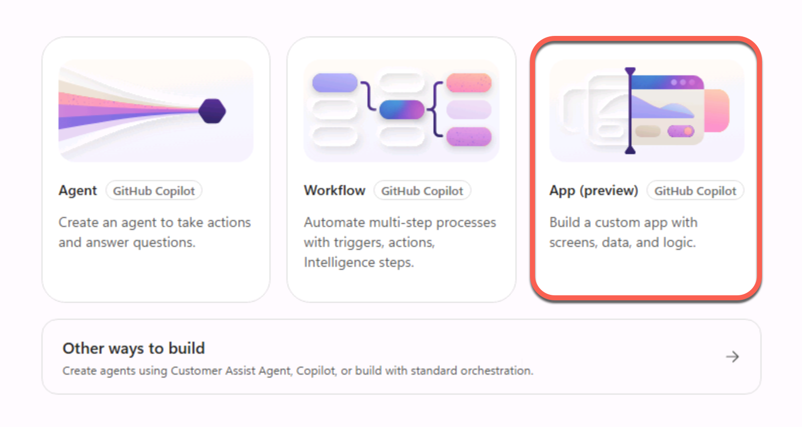
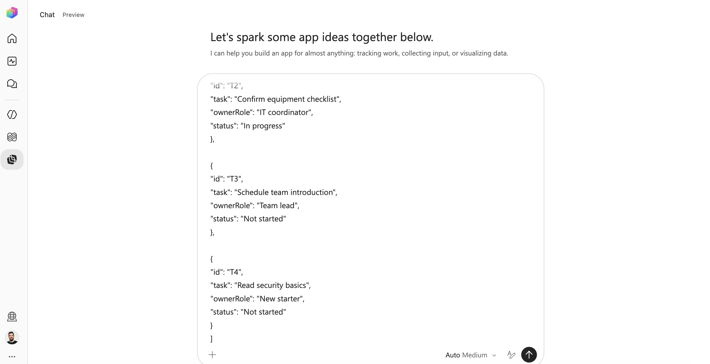
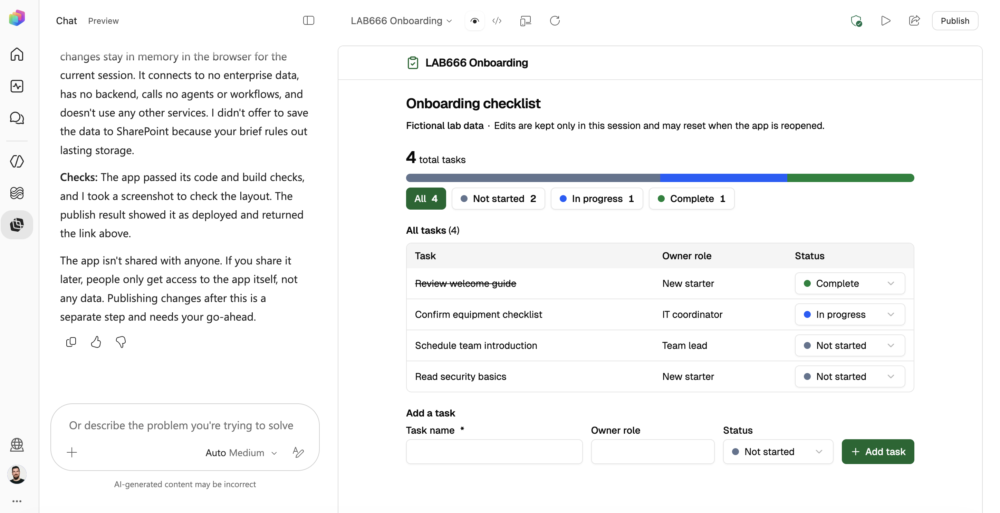
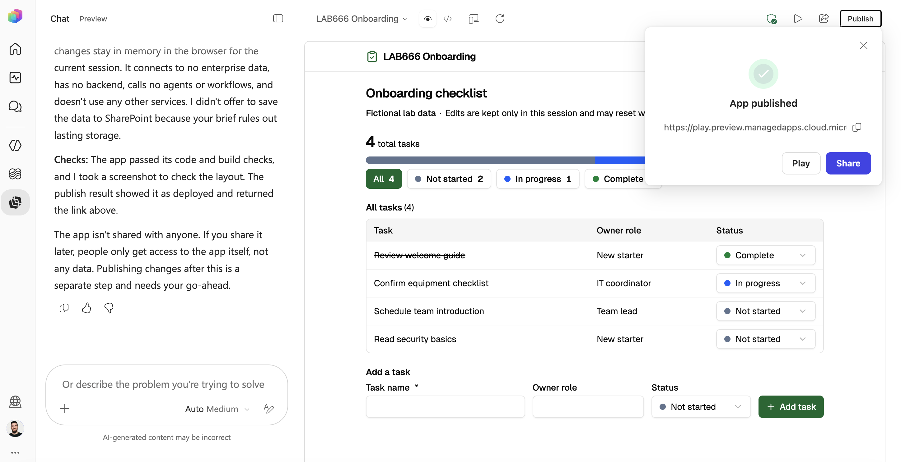
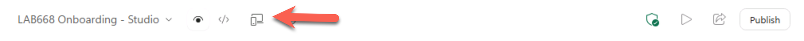
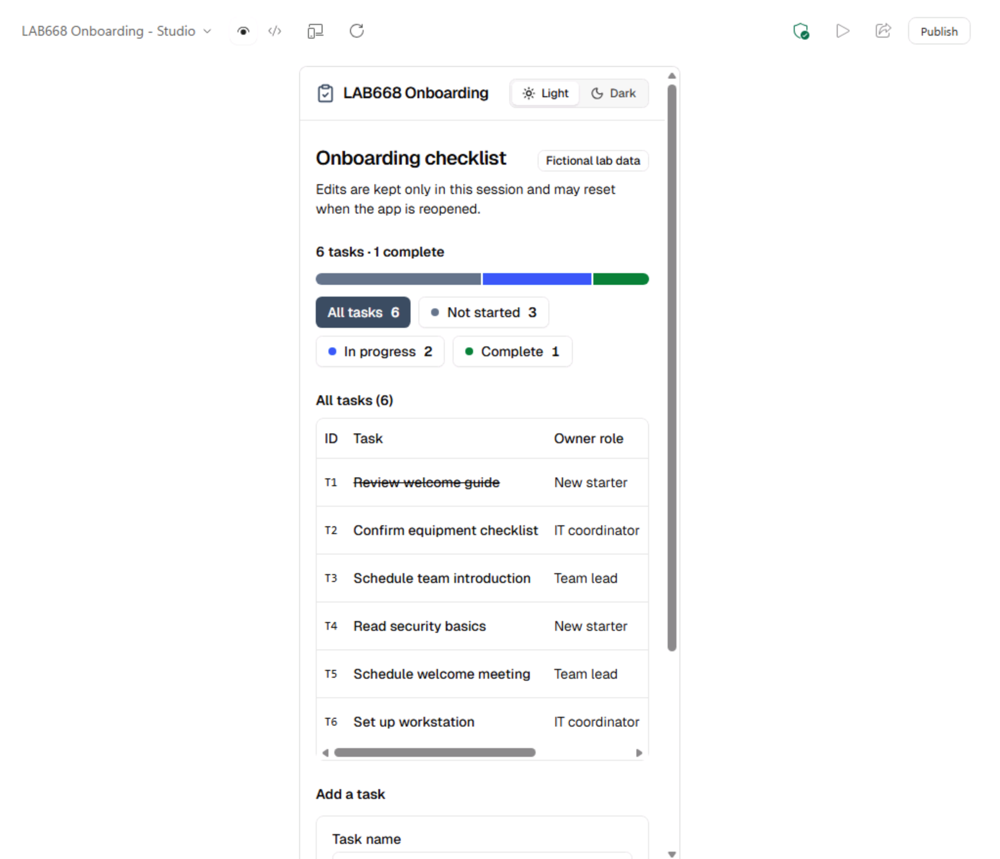

# 2 - Build the app with Copilot Studio

## Exercise 2 — Copilot Studio:

Copilot Studio supports enterprise agents, workflows and now apps. This exercise specifically uses **app creation**, not agent or workflow creation.

1. Open +++https://copilotstudio.microsoft.com/+++.
1. Select **App** from the homepage.
    

1. Type +++Create LAB668 Onboarding - Studio as a managed app.+++ Press **Shift + Enter** to insert a new line without sending the prompt. Then copy the entire **App brief text** block below and paste it into the same prompt. Copy the entire **JSON demo data fixture** block and paste it after the brief. Copy only the contents of each block, not the backticks. Create a separate app rather than importing a previous exercise's app.

    **App brief text**

    ```
    Create a supported interactive managed app for this lab, not a static HTML
    page, agent, or workflow. Use the exercise's LAB668 Onboarding title.

    Display a fictional onboarding checklist with task, owner role, and status.
    Status choices must be Not started, In progress, and Complete.
    Show the total task count and counts by status. Allow filtering by status,
    adding a task, and editing a task's status. Require a nonempty task name.
    Keep the interface small, readable, and keyboard usable.

    Start with the pasted JSON fixture. Label the screen "Fictional lab data".
    Use session-local or illustrative local state; do not connect to enterprise
    data or promise durable, shared, cross-user storage. State that edits may
    reset when reopened. Do not add a backend, call agents or workflows, or
    request additional services. Keep scope to this brief.

    Prepare the app for the entry point's supported Copilot Managed Runtime
    publish/deploy path. Do not treat a preview or source-code update as a
    confirmed hosted deployment.
    ```

    **JSON demo data fixture**

    ```json
    [
      {
        "id": "T1",
        "task": "Review welcome guide",
        "ownerRole": "New starter",
        "status": "Complete"
      },

      {
        "id": "T2",
        "task": "Confirm equipment checklist",
        "ownerRole": "IT coordinator",
        "status": "In progress"
      },

      {
        "id": "T3",
        "task": "Schedule team introduction",
        "ownerRole": "Team lead",
        "status": "Not started"
      },

      {
        "id": "T4",
        "task": "Read security basics",
        "ownerRole": "New starter",
        "status": "Not started"
      }
    ]
    ```

    Once the brief and JSON data are both in the same prompt, send it to Copilot Studio.

    

1. Generate and preview it. Run the standard preview test; request at most one focused correction.
    

1. Confirm “Fictional lab data” is visible and no enterprise connection was required. Keep the app self-contained for this exercise.

1. In the interactive app preview, use **Add a task** to create two fictional onboarding tasks:

    1. Enter +++Schedule welcome meeting+++ as the task name.
    1. Enter +++Team lead+++ as the owner role.
    1. Select **Not started** as the status, or keep it if already selected.
    1. Click **Add task**.
    1. Repeat these steps to add +++Set up workstation+++ with owner role +++IT coordinator+++ and status **In progress**.

    Confirm both tasks appear in the list and the total task count increases by two. These preview edits may reset when you open the app.

1. Select the **Publish** button on the top right to host the app in Copilot Managed Runtime. Now you can review the intended audience and capture the app link.
    

1. While publishing completes, review the default **full-screen** layout. Select the **Device preview** icon (a phone and monitor) in the toolbar once to switch to the **Tablet** layout, then select the same icon again to switch to the **Mobile** layout. Inspect each layout and confirm the app remains clear and usable at each size.

    

    

1. Once publishing finishes, open the app using the link in a new tab or click play.

1. Return to authoring and request this final revision:

    ```
    Keep the existing app and fixture unchanged.
    Add a light/dark mode switch so users can choose either appearance.
    Preserve all existing interactions.
    ```

1. Preview the revision, publish it, and reopen the app to confirm the switch works in both modes.

1. Return to authoring and select the **Code view** icon (**</>**) to inspect the generated code. Open the **src** folder and select **App.tsx** to view one of the generated files. Feel free to inspect the other source files. To switch back to the app view, select the **App preview** icon.

## Exercise end

You built and published a separate app with Copilot Studio, then added a light/dark mode switch as a revision. You reopened the app to confirm the switch works in both modes.

Select **Next** to continue to the following section.
