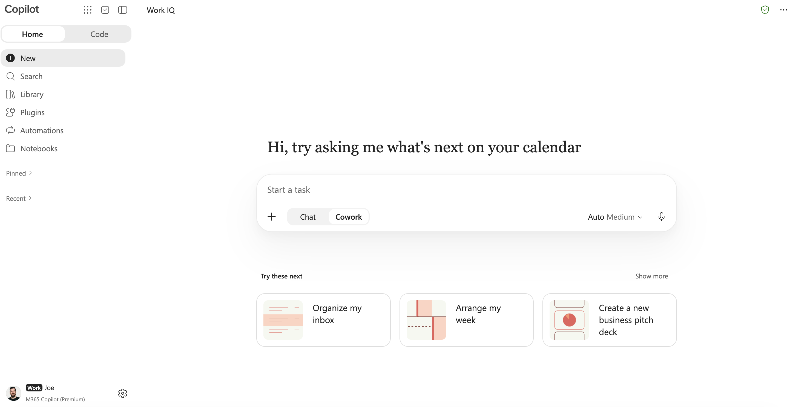
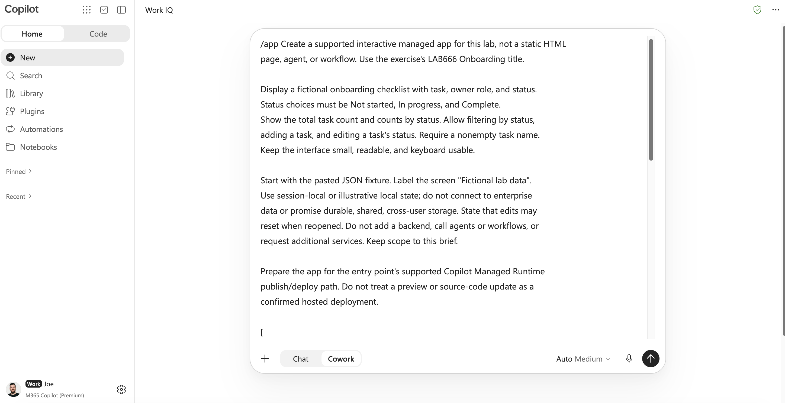
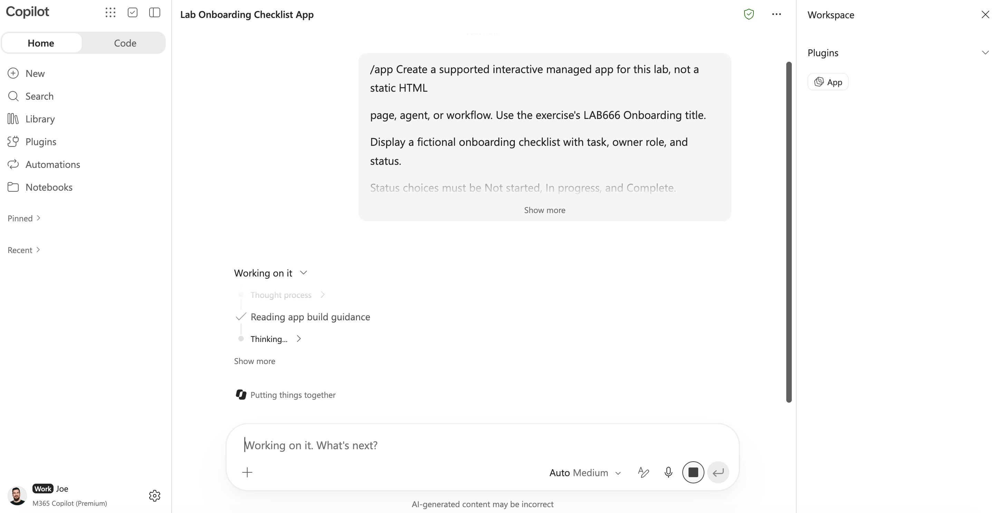
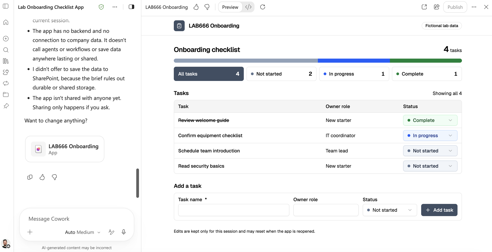
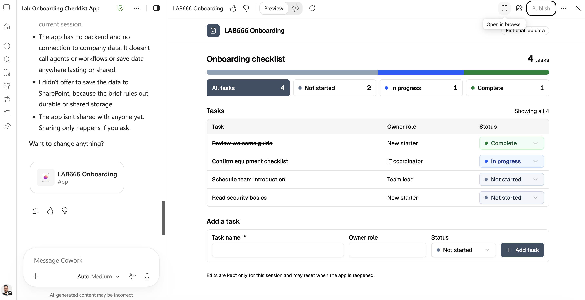
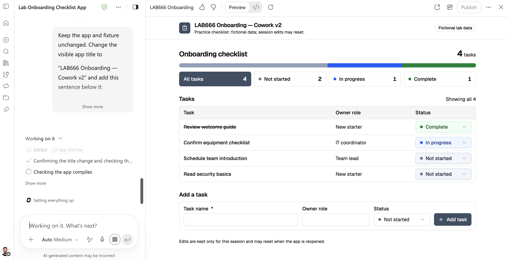
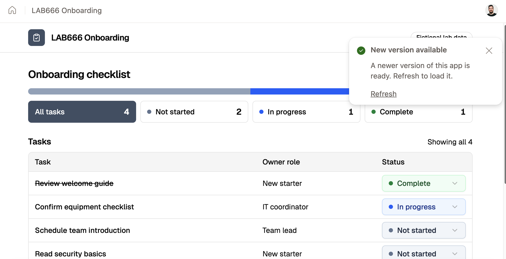
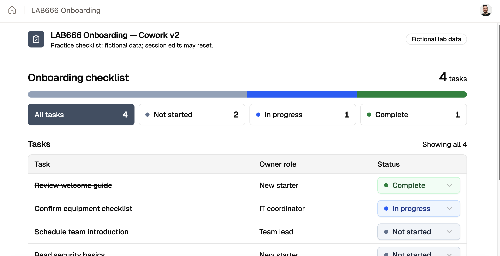

# Host apps from anywhere with the new Copilot Managed Runtime

**Focus:** Create apps and publish to Microsoft Copilot Managed Runtime, starting from familiar Microsoft experiences or third-party.

In this lab, you'll build interactive apps in Cowork and Copilot Studio, publish them to Copilot Managed Runtime (CMR), and open them outside the authoring preview. Each exercise uses the same fictional scenario to create a separate app. No manual transfer between products or prior coding experience is required.

The hands-on exercises focus on Cowork and Copilot Studio. You'll also learn how other entry points, including Code, and the SDK and CLI fit into the broader development experience. SDK and CLI coverage is presenter-led; no local installation is required.

Your facilitator will provide the lab account and access instructions for the features available in the session.

## Learning outcomes

By the end, you should be able to:

- Choose an authoring entry point based on intent: work tasks in Cowork or enterprise solutions in Copilot Studio.
- Create, preview, test, and publish a supported interactive app.
- Distinguish an authoring preview, editable source, and a hosted deployment.
- Make a visible change and verify it after republishing.
- Explain why app access, underlying data permissions, and Microsoft 365 administration are separate concerns.

These experiences overlap. The choice of starting point does not establish different intrinsic app capabilities or automatic cross-client handoff.

## Schedule

Times are elapsed minutes from the start of the session.

| Time | Minutes | Activity |
| --- | ---: | --- |
| 00–08 | 8 | Sign in, access check, and introduction |
| 03–23 | 15 | Overview |
| 23–43 | 20 | Exercise 1: Cowork create, test, publish, iterate, and republish |
| 43–63 | 20 | Exercise 2: Copilot Studio create, test, and publish |
| 63–68 | 5 | Hosted access/sharing check, SDK/CLI bridge, administration |
| 68–75 | 7 | Completion check, recap, and cleanup guidance |
| **Total** | **75** | |

Stop each exercise at its cutoff. If generation or publishing stalls, use the organizer's prepared fallback and continue; do not spend the next exercise troubleshooting.

## Common scenario, data, and prompt

Create a fictional employee onboarding checklist. Use role labels, not real employee information. Both apps use the same fixture so you can focus on authoring and hosting rather than inventing requirements.

Use the title +++LAB666 Onboarding — Cowork+++ or +++LAB666 Onboarding — Studio+++.

## Getting started: 

Select the **Resources** tab to find your Virtual Machine credentials and Microsoft 365 credentials. The green text with the +++icon+++ can be clicked on and will be typed automatically into the VM, For example, please click in the **Password** text box in the **Resources** tab to login to the Virtual Machine.

> [!NOTE]
> To ensure text is entered accurately, avoid interacting or clicking in the VM until the text has finished being typed.

## Verify your assigned resources

1. Confirm the **Resources** panel shows values for **ADMINISTRATIVE USERNAME** and **TEMPORARY ACCESS PASS**. You'll need these to login to the Microsoft 365 account.
1. Confirm the lab files exist in your Virtual Machine's hard drive at `D:\LabFiles`.
1. Open Microsoft Edge.

> [!NOTE]
> If credentials are missing, select **Refresh Credentials**. Wait for autotype to finish before interacting with the VM.

Ready to get started? Click **Next**.

# 1 - Build the app with Cowork

## App brief

Copy and paste this app brief into the app-creation experience, along with the JSON demo data fixture below. Add the short entry-point sentence shown in each exercise by typing it.

```
Create a supported interactive managed app for this lab, not a static HTML
page, agent, or workflow. Use the exercise's LAB666 Onboarding title.

Display a fictional onboarding checklist with task, owner role, and status.
Status choices must be Not started, In progress, and Complete.
Show the total task count and counts by status. Allow filtering by status,
adding a task, and editing a task's status. Require a nonempty task name.
Keep the interface small, readable, and keyboard usable.

Start with the pasted JSON fixture. Label the screen "Fictional lab data".
Use session-local or illustrative local state; do not connect to enterprise
data or promise durable, shared, cross-user storage. State that edits may
reset when reopened. Do not add a backend, call agents or workflows, or
request additional services. Keep scope to this brief.

Prepare the app for the entry point's supported Copilot Managed Runtime
publish/deploy path. Do not treat a preview or source-code update as a
confirmed hosted deployment.
```

```
[
  {
    "id": "T1",
    "task": "Review welcome guide",
    "ownerRole": "New starter",
    "status": "Complete"
  },

  {
    "id": "T2",
    "task": "Confirm equipment checklist",
    "ownerRole": "IT coordinator",
    "status": "In progress"
  },

  {
    "id": "T3",
    "task": "Schedule team introduction",
    "ownerRole": "Team lead",
    "status": "Not started"
  },

  {
    "id": "T4",
    "task": "Read security basics",
    "ownerRole": "New starter",
    "status": "Not started"
  }
]
```

## Exercise 1 — Cowork: 

Cowork fits broader work tasks where creating an app is part of getting the work done. Build, publish, and then revise the same app in this exercise.


1. Go to +++[https://copilot.cloud.microsoft/home](https://copilot.cloud.microsoft/home)+++
2. Enter the user name and password.
3. Select the +++Cowork++ button.

4. Type +++/app+++.
5. Type +++In Cowork, create LAB666 Onboarding — Cowork as a managed app.+++ Then paste the common brief and fixture.

6. Allow generation to finish. Confirm you received an interactive app rather than only an explanation or static document. Observe its authoring preview.

7. Run a standard preview test, ensuring everything is working. If needed, type one focused correction such as +++Keep the existing app. Fix only the failing checklist test and preserve the fixture and scope.+++

8. If your app was not published, click publish to deploy to Copilot Managed Runtime, making your app hosted, secure, governed and shareable.
9. Click **Open in browser**. This will then open it in a new browser tab (make sure you're using the same lab account if you cannot access), confirm the app looks and works the same.

10. Return to authoring and request this small change:

   ```
   Keep the app and fixture unchanged. Change the visible app title to
   "LAB666 Onboarding — Cowork v2" and add this sentence below it:
   "Practice checklist: fictional data; session edits may reset."
   Keep all existing interactions working.
   ```


11. Confirm the new title and sentence in preview.
12. Click publish. Then, once published, reopen or refresh the current hosted deployment link independently of authoring. Selected "refresh" on the updated app pop-up. Confirm “Cowork v2” and the new sentence appear, then test filtering and adding a task again.

13. Check the title.


**Checkpoint:** A hosted app opens independently of the Cowork preview and shows the revision with working interactions. Preview alone is not completion; iIf publishing fails, observe the prepared hosted app by the lab providers. 

===

## Exercise 2 — Copilot Studio: 

Copilot Studio supports enterprise agents, workflows and now apps. This exercise specifically uses **app creation**, not agent or workflow creation.

> **Feature gate:** If users are unable to create using MCS, this segment becomes a facilitator demonstration using the prepared prompt above. 

1. Open +++https://copilotstudio.microsoft.com/+++. Confirm you are in the lab tenant.
2. Type +++In Copilot Studio, create LAB666 Onboarding — Studio as a managed app.+++ Then paste the common brief and fixture. Create a separate app rather than importing a previous exercise's app.
3. Generate and preview it. Run the standard preview test; request at most one focused correction.
4. Confirm “Fictional lab data” is visible and no enterprise connection was required. Keep the app self-contained for this exercise.
5. Use Studio's supported app deployment/publishing controls to host the app in CMR. Review the intended audience and capture the hosted deployment link.
6. Open that link independently. Repeat the load, filter, add, and status-edit tests. Reopening may reset local edits; that is compatible with this lab's scope.
7. Record the hosted link and outcome. If the feature gate or deployment blocks you, follow the prepared demonstration and record “observed” plus the reason.

**Checkpoint:** A Studio-authored supported app runs at its hosted link, or the worksheet honestly records a demonstration-only outcome. Apps built in Studio can use connectors, but cannot call agents or workflows from the app.

===

## Hosted access, developer bridge, and governance: 

### Verify access and sharing

Choose one app you successfully deployed. Open its hosted link independently and demonstrate one interaction. Where approved sharing controls are available, grant only the designated lab partner or group access. Have that partner open the link using their own approved account; do not exchange credentials. If no authorized partner is available, observe the facilitator's access test.

A link is not itself a permission grant. App-use permission, source edit permission, and rights to a connected data source are distinct. The fixture demonstrates no enterprise-data authorization, and two users may see separate local state.

### Presenter-led SDK/CLI bridge

Discussion for how developers with tenant access and app edit rights can clone editable source from platform-managed Git using the supported CLI and continue in compatible tools. That developer path has prerequisites such as the CLI, Node.js, and Git credential management; attendees do not need to install anything here.

The conceptual sequence is **obtain source → edit locally → build/preview → deploy → share**. Pushing source to Git is not live deployment. SDK/CLI guidance covers configuration, typed data services, local development, preview, deployment, and sharing; use current documentation for exact commands, packages, and supported app requirements.

### Presenter-led administration

The presenters will, using an approved administrator account, will show the relevant validated app-management view in **Microsoft 365 administration** and identify available identity, access, and data controls.

## Session validation: 

- [ ] I opened at least one app I deployed at a hosted link outside authoring preview.
- [ ] I tested fixture counts, filtering, task creation, and status editing.
- [ ] I verified the Cowork revision after republishing, or recorded why it was not completed.
- [ ] I can explain preview versus deployment, and app sharing versus data rights.

Keep a private note of your app titles and hosted links. Remove only your own lab apps and sharing grants through supported lifecycle controls if instructed. Do not delete prepared shared apps, data sources, or tenant settings. The organizer supplies the retention policy; there is no scripted cleanup in this guide.

## Troubleshooting

| Symptom | Action |
| --- | --- |
| Entry point or publish controls missing | Confirm account/tenant with facilitator; use the approved demonstration |
| Generation stalls or app is noninteractive | Try one focused correction, then use fallback at the cutoff |
| Preview works but hosted link fails | Check deployment outcome, URL type, signed-in account, and authorized audience |
| Hosted app still shows the old title | Confirm republish completed and reopen the current deployment link |
| Connector asks for unexpected consent | Stop; core exercises require no connector or additional permissions |

## Organizer readiness — complete before the event

Supply the following in the session handout; no endpoints or prepared assets are assumed to exist in this repository.

| Required information | Organizer-supplied value |
| --- | --- |
| Lab account, tenant, and seat identifiers | Supply approved account instructions |
| Cowork and Copilot Studio entry points | Supply validated URLs |
| Supported app creation/publish route for each | Supply current UI labels, destination selection, and any entitlement requirements |
| Studio availability and alternative | Confirm hands-on enabled, or announce facilitator-only demonstration |
| Prepared fallback per entry point | Supply approved preview/hosted links and a recorded alternative if needed |
| Sharing target and retention | Supply approved partner/group and cleanup policy |
| Administration demonstration | Supply approved admin account and validated Microsoft 365 view |

Rehearse both exercises with an attendee-equivalent account. Measure generation, publish, and Cowork republish against the cutoffs; verify fixture tests, permissions, and independent hosted access. Check the Studio feature gate explicitly. Prepare separate fallback apps in advance, including the Cowork before/after revision.

### Continue learning

+++https://learn.microsoft.com/en-us/microsoft-365/managed-apps/+++
